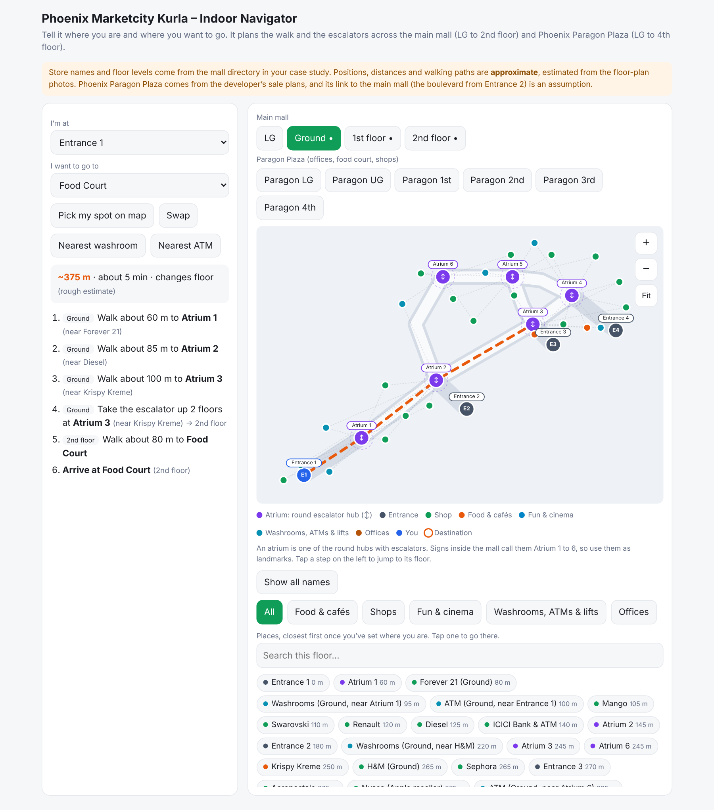
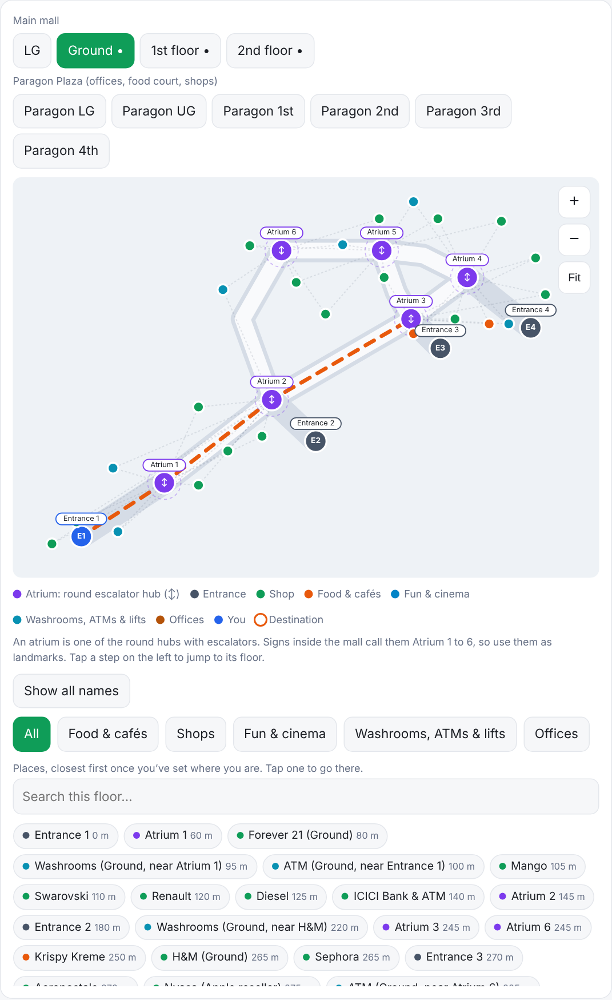
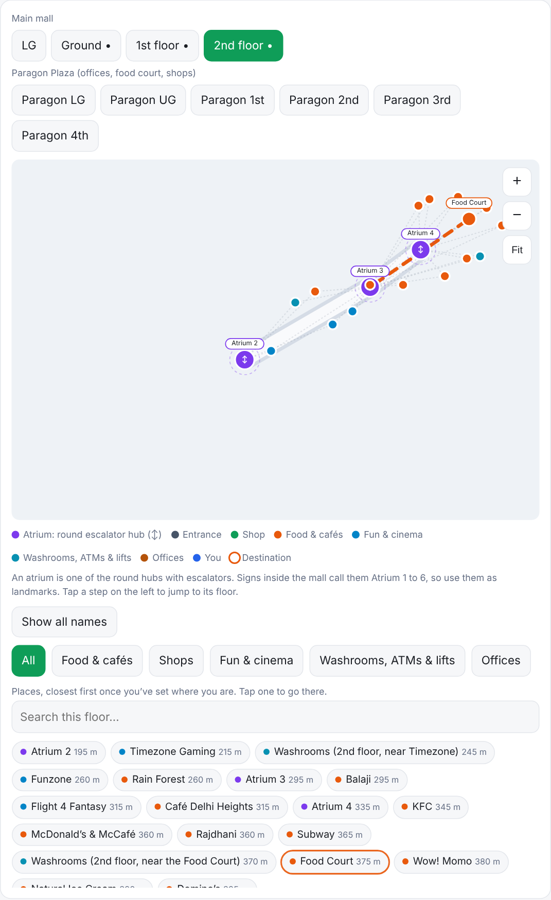
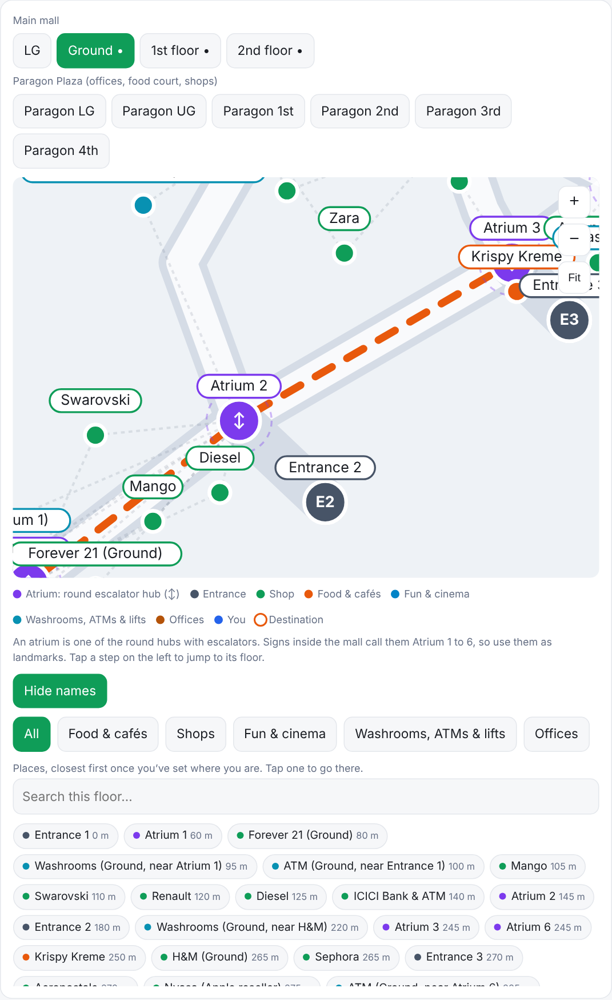
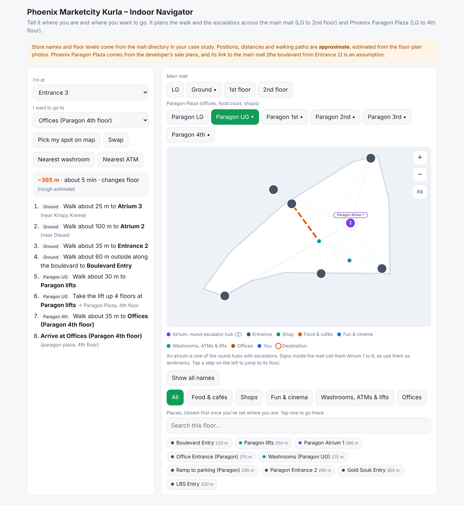
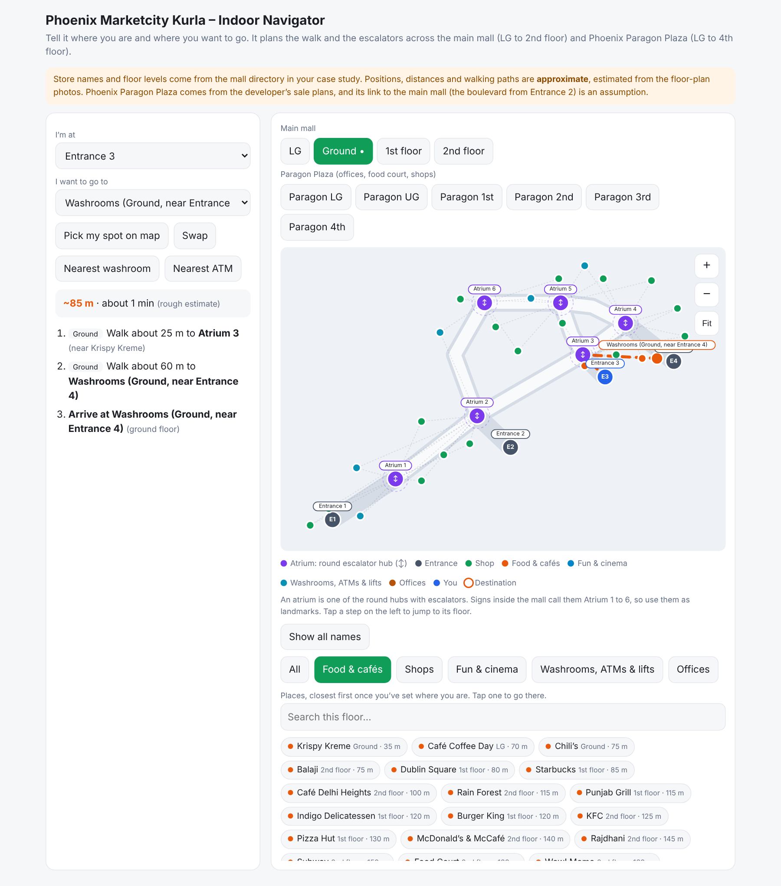
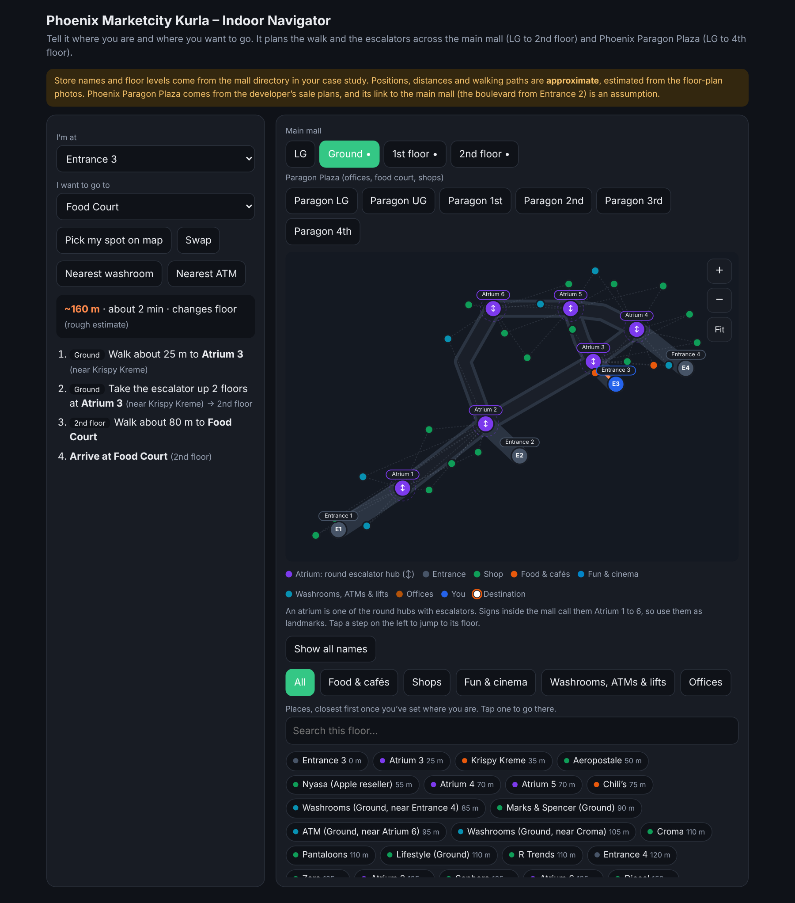
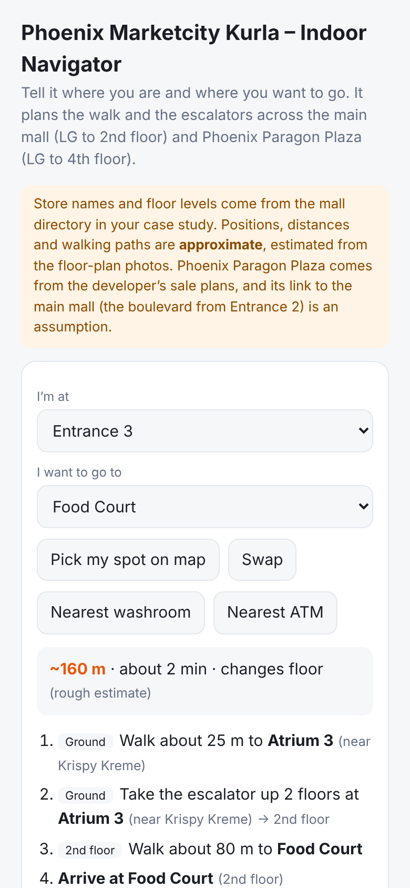
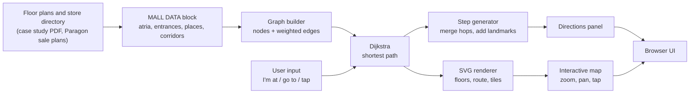

# Mall Navigator: Indoor Navigation for Phoenix Marketcity Kurla

An interactive indoor wayfinding web app for **Phoenix Marketcity, Kurla (Mumbai)** and its adjoining **Phoenix Paragon Plaza**. Tell it where you are and where you want to go, and it plans the walk across floors, with escalators, lifts, distance, time and step-by-step directions.

GPS can't place you inside a mall or tell floors apart, so the app works the way a mall directory kiosk does: you say where you are (an entrance, an atrium or a store), and it does the rest.



## Features

- **Multi-floor routing.** Shortest walking route between any two places, across 4 mall levels (LG, Ground, 1st, 2nd) and 6 Paragon Plaza levels (LG to 4th).
- **Step-by-step directions** with floor badges, landmarks ("near Forever 21") and rough distance and time. Tap a step to jump to its floor.
- **Interactive map.** Zoom (buttons, wheel, pinch), drag to pan, tap any place to select it, tap anywhere to set "I'm here".
- **Nearest washroom / ATM** in one tap, measured by walking route, including other floors.
- **Browse by category** (food, shops, fun and cinema, washrooms/ATMs/lifts, offices), listed closest first with distances.
- **Search** across every floor.
- Light and dark mode, responsive layout, reduced-motion support, and a searchable place list that works without the map.
- **Zero dependencies.** One HTML file (plain HTML, CSS, JavaScript and SVG). Works offline and on GitHub Pages.

## Screenshots

| Route on the ground floor | Arriving at the food court (2nd floor) |
|---|---|
|  |  |

| Zoomed in with store names | Phoenix Paragon Plaza route |
|---|---|
|  |  |

| Nearest washroom and categories | Dark mode | Mobile |
|---|---|---|
|  |  |  |

## How it works (in one minute)

The mall is modelled as a **weighted graph**.

1. **Nodes** are places you can start from or go to: entrances, atria (the round escalator hubs), stores, food stalls, washrooms, ATMs, lifts.
2. **Edges** are walkable connections. A walking edge's weight is its real length in metres. An escalator or lift edge has a fixed cost (25 m for an escalator hop, 20 m for a lift hop).
3. **Shortest path** between two nodes is found with **Dijkstra's algorithm**.
4. The path is turned into **human steps**: consecutive escalator hops at the same atrium are merged ("take the escalator up 2 floors"), and each atrium is described by a nearby store.
5. The result is drawn on an **SVG map** with an animated route line.



See [docs/ARCHITECTURE.md](docs/ARCHITECTURE.md) for the data model, routing logic, cost model and design decisions.

## Project structure

```
.
├── index.html               The entire app (data + engine + UI)
├── README.md
└── docs/
    ├── ARCHITECTURE.md      Design, data model, algorithms, limitations
    ├── diagrams/            PNG copies of the diagrams
    └── screenshots/         Images used in this README
```

Inside `index.html` the code is organised in three blocks:

| Block | What it contains |
|---|---|
| `MALL DATA` | Levels, atrium positions, corridors, entrances, places, Paragon Plaza data |
| `ENGINE` | Graph construction, Dijkstra, distance model |
| `VIEW` and `STATE + DRAW` | Zoom and pan, tap handling, SVG drawing, directions, lists |

## Run it

Open `index.html` in any modern browser. There is no build step.

To host it for free: push the repo to GitHub, then **Settings → Pages → Deploy from branch → `main` / root**.

## Data sources

- **Main mall:** a Phoenix Marketcity Kurla case study (floor-plan photos of the LG, Ground, 1st and 2nd floors, the directory of stores with levels, the site plan).
- **Paragon Plaza:** the developer's sale floor plans (LG, Upper Ground, 1st to 4th floor) from the Phoenix Offices website.

## Accuracy and limitations

Be aware of what this is and isn't:

- Store names and floor levels come from the mall directory. **Positions, distances and walking paths are estimates** read off plan photos, not surveyed measurements.
- Only about 55 stores of the mall's roughly 300 are included so far.
- The link between the main mall and Paragon Plaza (the boulevard from Entrance 2) is an assumption.
- There is no live data (opening hours, crowds, store changes).
- No step-free (lift-only) route yet.

## Roadmap

- Add the full store directory with real positions
- Step-free route option using lifts
- QR codes at each atrium to set "I'm here" instantly
- Parking levels and car-to-store routing
- Support for more malls (Seawoods Grand Central, Lower Parel, R City Ghatkopar, Viviana Mulund)

## Add a place, floor or mall

Everything lives in the data block at the top of the script. For example, to add a store:

```js
// [name, level (0=LG, 1=Ground, 2=1st, 3=2nd), x, y, type]
["Zara", 1, 700, 290, "shop"]
```

Types: `shop`, `food`, `fun`, `svc` (washrooms, ATMs, lifts), `ent`, `off`. The store is automatically connected to its two nearest atria on that level. Coordinates are in plan-image pixels; see the architecture doc for the coordinate system.

## Tech stack

HTML, CSS (custom properties for theming), vanilla JavaScript, SVG. No framework, no build tools.

## Author

Built by Riddhi Chavan ([riddhichavan.com](https://riddhichavan.com)).
