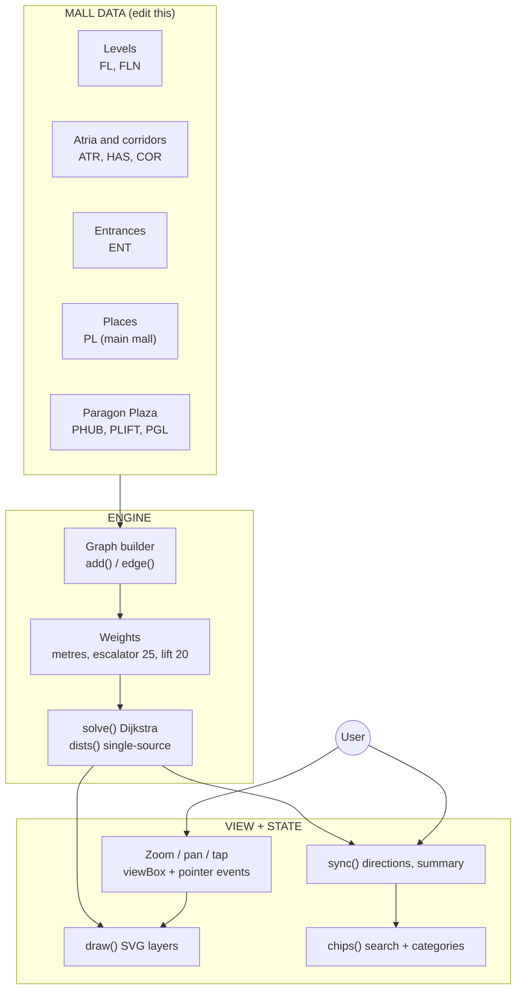

# Architecture and design notes

This document explains how Mall Navigator is built: the data model, how the graph is constructed, how routes are computed and turned into directions, and the trade-offs behind the design.

## 1. Goals and constraints

- **Work inside a mall, where GPS doesn't.** The app can't know your position or floor, so the user states it (entrance, atrium, store, or a tap on the map).
- **Run anywhere with no setup.** One static HTML file, no backend, no build, no API keys, so it can be hosted on GitHub Pages.
- **Data-driven.** Adding a store, floor or mall means editing data, not logic.
- **Honest about accuracy.** The source material is floor-plan photos and PDFs, so everything is approximate and the UI says so.

## 2. High-level architecture



## 3. Data model

Everything is a **node** or an **edge**.

```js
node = { id, name, f /*level index*/, p /*[x,y]*/, t /*type*/ }
edge = { a, b, via /*bend points*/, x /*fixed cost*/, v /*vertical?*/, k /*length scale*/, tag /*"lift"|"link"*/, len /*metres*/ }
```

**Levels** are numbered globally. `0..3` are the main mall (LG, Ground, 1st, 2nd). `4..9` are Paragon Plaza (LG, UG, 1st to 4th). Keeping one flat list of levels lets a single graph cover both buildings.

**Node types**

| Type | Meaning | Colour |
|---|---|---|
| `atr` | Atrium, the round escalator hub, used as a routing waypoint | purple |
| `ent` | Entrance | grey |
| `shop` | Store | green |
| `food` | Food and cafés | orange |
| `fun` | Cinema, games, entertainment | blue |
| `svc` | Washrooms, ATMs, lifts | teal |
| `off` | Offices (Paragon Plaza) | brown |

**Coordinates.** Main mall positions are pixel coordinates in the ground-floor plan image from the case study (all floors share one frame so atria line up vertically). Paragon Plaza positions are pixel coordinates in its own plan images, mapped into the same frame by `PG(x, y)` so the renderer needs a single projection `X()`.

## 4. How the graph is built

1. **Atria** are created on each level where the plan shows them (`HAS[level]`).
2. **Corridors** (`COR`) join atria pairs on every level where both exist, with optional bend points (`via`) so corridors can curve around the building.
3. **Vertical edges** join the same atrium on consecutive levels with a fixed cost (25 m, one escalator hop). They are marked `v: true` so they are not drawn and are described as escalator or lift steps.
4. **Entrances** attach to the ground-floor atrium beside them (Entrance 1 to Atrium 1, 2 to 2, 3 to 3, 4 to 4).
5. **Places** attach to their **two nearest atria** on the same level. Two links (not one) give the router a choice, which avoids forcing a detour through a single hub.
6. **Paragon Plaza** is built from `PHUB` (escalator hub) and `PLIFT` (lift lobby) per level, plus landmarks in `PGL`. Lifts connect every level (20 m per hop); escalators connect UG, 1st and 2nd.
7. **The two buildings are joined** by a single `link` edge from the mall's Entrance 2 to Paragon's Boulevard Entry (60 m). This link is an assumption (see Limitations).

## 5. Routing

### Shortest path

`solve(a, b)` is Dijkstra's algorithm over about 130 nodes. A simple O(n²) implementation is more than fast enough, so there is no priority queue.

`dists(a)` runs the same algorithm and returns distances to every node. It powers "nearest washroom / ATM" and the "closest first" ordering of place lists.

### Cost model

| Edge | Cost |
|---|---|
| Walking | length in plan pixels × 0.3 m per pixel (`MPP`) |
| Paragon walking | the same, scaled by `k = 0.47` because its plan images use a different scale |
| Escalator hop | 25 m |
| Lift hop | 20 m |
| Boulevard link | 60 m |

Walking speed for the time estimate is 1.3 m/s.

### Tie-breaking

An early version sometimes returned zig-zag routes: one escalator ride up at Atrium 1, a walk along the first floor, another ride at Atrium 2. These routes have exactly the same cost as one ride of two floors, so Dijkstra picked arbitrarily. A tiny per-level surcharge (0.05% per level) on walking edges now makes the router prefer walking on the lowest floor and taking the rides together. The effect on displayed distances is far below the 5 m rounding.

## 6. From path to directions

`sync()` converts the path into steps:

- Consecutive vertical hops at the same atrium merge: "Take the escalator up 2 floors at Atrium 3".
- Consecutive walking segments toward the same node are collapsed.
- The `link` edge becomes "Walk about 60 m outside along the boulevard to Boulevard Entry".
- Atria are described by a nearby store from a per-level lookup (`LMK`), because "Atrium 3" alone means little to a visitor who hasn't memorised the mall.
- Each step carries a floor badge, and tapping it switches the map to that floor.

## 7. Rendering and interaction

The map is a single `<svg>` whose `viewBox` is the viewport, so **zoom and pan are just changes to the viewBox**. There is no canvas and no library.

- **Zoom:** buttons, mouse wheel, and pinch (two pointers). Zoom is clamped between 1× and 6×.
- **Pan:** one-pointer drag; a movement under 6 px counts as a tap.
- **Tap:** converted to SVG coordinates with `getScreenCTM().inverse()`, then snapped to the nearest node on the current floor. In "Pick my spot" mode, a tap anywhere snaps to the closest place.
- **Layers** (drawn in order): Paragon building outline, corridors, spurs (faint dashed lines from places to atria), the animated route, nodes, name tiles.
- **Progressive detail:** name tiles appear when zoomed in (or via "Show all names") to keep the overview readable.
- **Theming:** CSS custom properties with a dark variant, so the SVG follows the system theme.

## 8. Decisions and trade-offs

| Decision | Why | Cost |
|---|---|---|
| Single HTML file | Trivial to host, share and review | The file is long; modules would be tidier |
| Graph + Dijkstra | Correct, simple and easy to explain | Needs hand-authored connectivity |
| User states location | GPS fails indoors; no beacons needed | One extra tap |
| Atria as waypoints | Matches the real structure and signage of the mall | Places link to atria, not to corridors |
| Approximate coordinates | Source is plan photos | Distances are estimates |
| Vanilla JS + SVG | No build tooling, no dependencies | Manual DOM updates |

## 9. Limitations

- Positions, distances and paths are estimated from plan images, not surveyed.
- Straight "spur" lines from stores to atria can visually cross shop frontages.
- Only a subset of stores is included.
- The main mall to Paragon link is assumed.
- Lifts in the main mall are not modelled (the plans don't show them clearly), so there is no step-free route yet.
- No live data.

## 10. Extending

- **New store:** add a row to `PL`.
- **New floor or atrium:** update `FL`, `FLN`, `HAS` and `COR`.
- **New mall:** replace the data block; the engine and UI are data-agnostic.
- **Step-free routing:** add lift edges to the main mall, mark escalator edges `escalator: true`, and have `solve()` skip them when the toggle is on.
- **Real coordinates:** swap pixel coordinates for surveyed metres and set `MPP` to 1.
